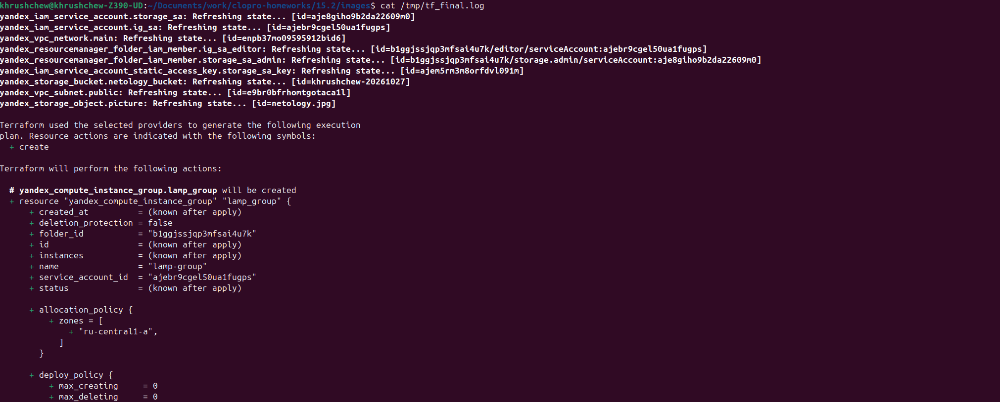
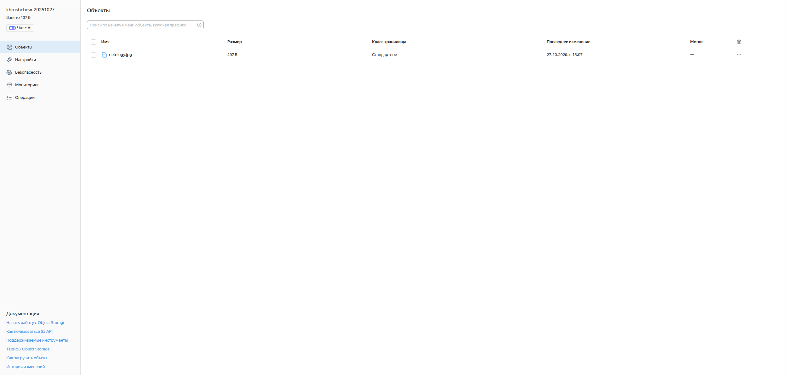
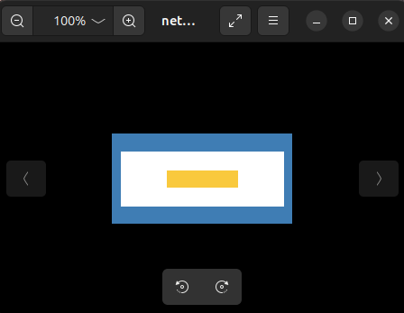
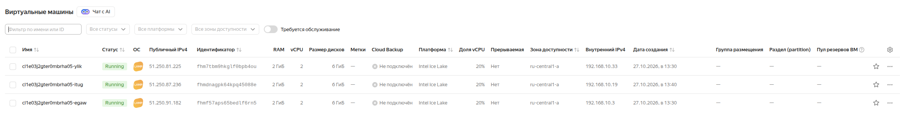
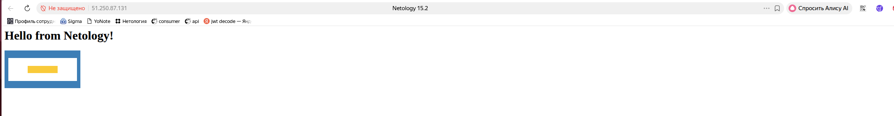
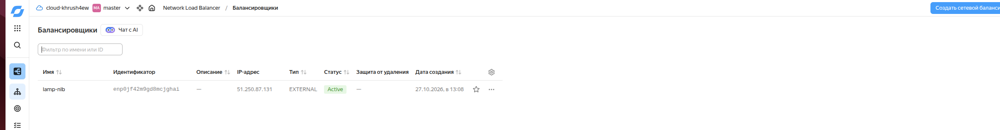
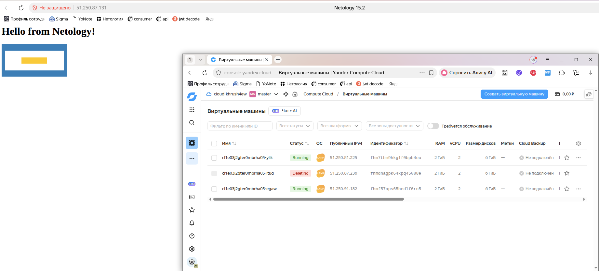
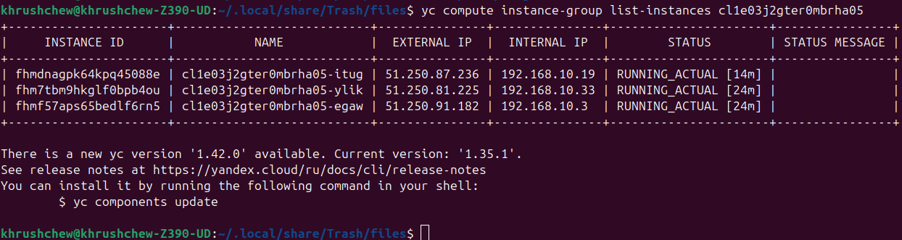

# Домашнее задание 15.2 — Вычислительные мощности. Балансировщики нагрузки (Yandex Cloud)

## Задание 1. Yandex Cloud

### Что сделано

1. **Object Storage (бакет)** `khrushchew-20261027`:
   - Создан бакет с публичным доступом на чтение (`anonymous_access_flags.read = true`).
   - Загружен файл-картинка `netology.jpg` с ACL `public-read`.
   - Публичный URL: `https://storage.yandexcloud.net/khrushchew-20261027/netology.jpg`

2. **Instance Group** `lamp-group` (3 ВМ, шаблон LAMP `fd827b91d99psvq5fjit`):
   - Три ВМ в публичной подсети `192.168.10.0/24`.
   - `user-data` формирует стартовую веб-страницу с тегом `` — ссылкой на картинку из бакета.
   - Настроен health check по HTTP (порт 80, путь `/`).

3. **Network Load Balancer** `lamp-nlb`:
   - Слушает порт 80 (внешний IP: `51.250.87.131`).
   - Подключена target group из Instance Group.
   - Health check по HTTP (порт 80, путь `/`).

---

## Terraform-манифесты

| Файл | Описание |
|---|---|
| [`main.tf`](main.tf) | Основная конфигурация: VPC, бакет, Instance Group, NLB |
| [`variables.tf`](variables.tf) | Переменные |
| [`outputs.tf`](outputs.tf) | Outputs: URL бакета, IP балансировщика |
| [`terraform.tfvars.example`](terraform.tfvars.example) | Пример файла переменных |

---

## Выполнение

### 1. Инициализация и применение Terraform

```bash
cp terraform.tfvars.example terraform.tfvars
# Заполнить yc_token: yc iam create-token

terraform init
terraform plan
terraform apply
```

### 2. Результат `terraform apply` — созданные ресурсы



```
instance_group_id = "cl1e03j2gter0mbrha05"
nlb_ip_address    = [["51.250.87.131"]]
bucket_url        = "https://storage.yandexcloud.net/khrushchew-20261027/netology.jpg"
target_group_id   = "enp6od7nolccd35t42g6"
```

---

### 3. Бакет Object Storage с картинкой



Публичный URL картинки:
`https://storage.yandexcloud.net/khrushchew-20261027/netology.jpg`



---

### 4. Instance Group — 3 ВМ в статусе RUNNING



```
| fhmdnagpk64kpq45088e | cl1e03j2gter0mbrha05-itug | 51.250.87.236 | 192.168.10.19 | RUNNING_ACTUAL |
| fhm7tbm9hkglf0bpb4ou | cl1e03j2gter0mbrha05-ylik | 51.250.81.225 | 192.168.10.33 | RUNNING_ACTUAL |
| fhmf57aps65bedlf6rn5 | cl1e03j2gter0mbrha05-egaw | 51.250.91.182 | 192.168.10.3  | RUNNING_ACTUAL |
```

---

### 5. Веб-страница ВМ со ссылкой на картинку из бакета

```bash
curl http://51.250.87.131/
# <html><head><title>Netology 15.2</title></head><body>
# <h1>Hello from Netology!</h1>
# 
# </body></html>
```



---

### 6. Сетевой балансировщик подключён к Instance Group



```
name:   lamp-nlb
status: ACTIVE
listener: 51.250.87.131:80 → target_group enp6od7nolccd35t42g6
```

---

### 7. Проверка отказоустойчивости — удаление одной ВМ

Удалена одна ВМ из группы. NLB автоматически исключил её из ротации,
сайт продолжал отвечать на оставшихся двух ВМ.



---

### 8. Instance Group автоматически восстановила ВМ

Instance Group обнаружила недостаток ВМ и автоматически пересоздала удалённую.


