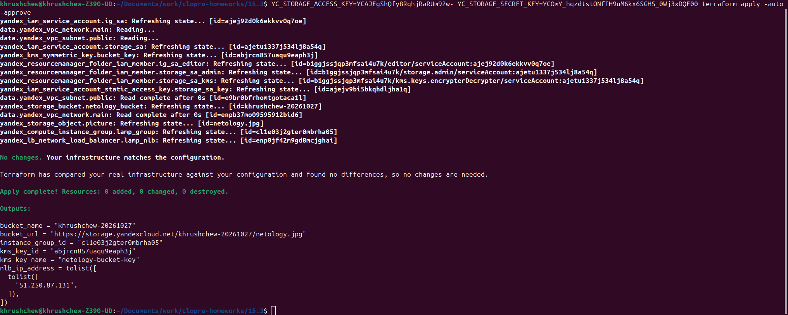
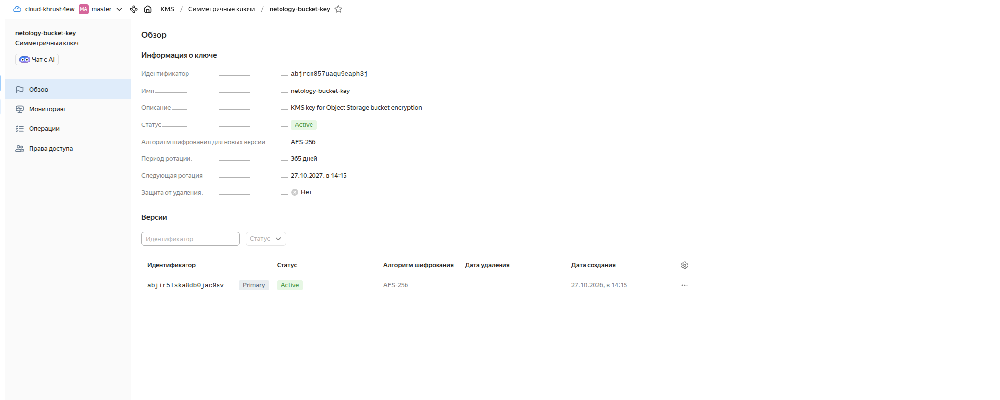
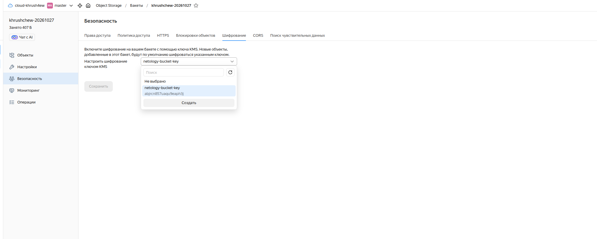

# Домашнее задание 15.3 — Безопасность в облачных провайдерах

## Задание 1. Yandex Cloud — шифрование бакета с помощью KMS

### Описание решения

На основе инфраструктуры из задания 15.2 добавлено шифрование Object Storage бакета с помощью Yandex KMS (Key Management Service).

**Что добавлено:**
- Создан симметричный KMS-ключ (`yandex_kms_symmetric_key`) с алгоритмом AES-256 и ротацией раз в год
- Сервисному аккаунту хранилища выдана роль `kms.keys.encrypterDecrypter` для работы с ключом
- В конфигурацию бакета добавлен блок `server_side_encryption_configuration` с использованием созданного ключа

### Terraform-манифесты

Файлы конфигурации находятся в папке [`15.3/`](./):
- [`main.tf`](./main.tf) — основная конфигурация
- [`variables.tf`](./variables.tf) — переменные
- [`outputs.tf`](./outputs.tf) — выходные значения
- [`terraform.tfvars.example`](./terraform.tfvars.example) — пример файла переменных

### Ключевые блоки конфигурации

**KMS ключ:**
```hcl
resource "yandex_kms_symmetric_key" "bucket_key" {
  name              = var.kms_key_name
  description       = "KMS key for Object Storage bucket encryption"
  default_algorithm = "AES_256"
  rotation_period   = "8760h"
}
```

**Права сервисного аккаунта на использование KMS ключа:**
```hcl
resource "yandex_resourcemanager_folder_iam_member" "storage_sa_kms" {
  folder_id = var.yc_folder_id
  role      = "kms.keys.encrypterDecrypter"
  member    = "serviceAccount:${yandex_iam_service_account.storage_sa.id}"
}
```

**Шифрование бакета:**
```hcl
resource "yandex_storage_bucket" "netology_bucket" {
  bucket     = var.bucket_name
  access_key = yandex_iam_service_account_static_access_key.storage_sa_key.access_key
  secret_key = yandex_iam_service_account_static_access_key.storage_sa_key.secret_key

  server_side_encryption_configuration {
    rule {
      apply_server_side_encryption_by_default {
        kms_master_key_id = yandex_kms_symmetric_key.bucket_key.id
        sse_algorithm     = "aws:kms"
      }
    }
  }
  ...
}
```

### Результаты выполнения

#### 1. terraform apply — инфраструктура соответствует конфигурации, outputs показывают созданный KMS ключ



#### 2. KMS ключ `netology-bucket-key` в Yandex Cloud Console — статус Active, алгоритм AES-256, ротация 365 дней



#### 3. Вкладка «Шифрование» бакета `khrushchew-20261027` — настроено шифрование ключом `netology-bucket-key` (ID: `abjrcn857uaqu9eaph3j`)


